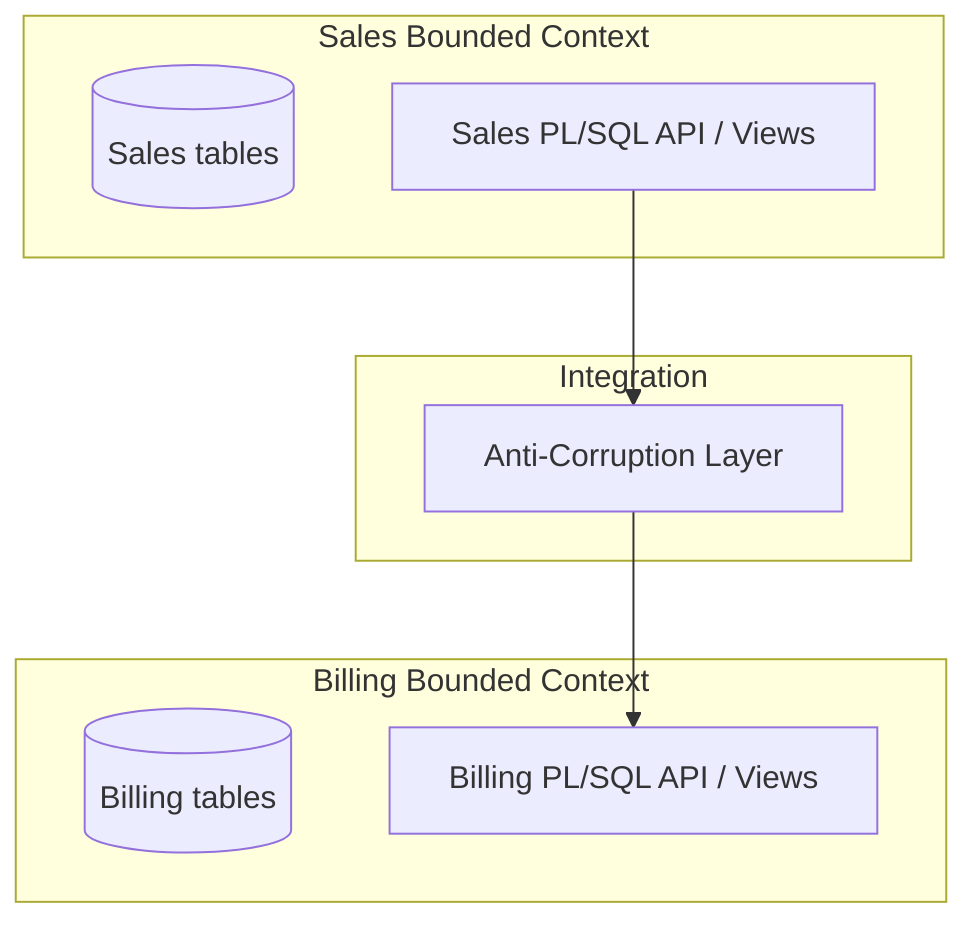

# Clean Code, Clean Architecture & DDD for Oracle

This supersedes the generic `code-standards/software-architecture` skill for Oracle PL/SQL —
read this file first for Oracle architecture/domain-modeling decisions and fall back to the
generic skill only for concerns not covered here.

## Layered Architecture Model

```
Domain Layer
  Entities / Value Objects / Aggregates / Domain Services
    ↑ used by
Application Layer
  Use Cases / Application Services / Repository Interfaces / Unit of Work boundary
    ↑ implemented by
Infrastructure Layer
  Repository implementations → SQL / PL/SQL packages → Oracle data model
```

Oracle tables, indexes, partitions, and optimizer shaping are **implementation details** in this model. Oracle-specific power is not rejected — it is isolated behind repository and application service boundaries.

---

## Bounded Contexts → Oracle Schema Boundaries

Map each bounded context to a schema (or at minimum a stable ownership boundary):

- Each bounded context **owns** its tables; exposes integration contracts explicitly (views, PL/SQL APIs, events)
- No direct cross-domain writes — use anti-corruption layers (ACLs) at the boundary
- Grant `EXECUTE` on package APIs, not `SELECT/INSERT/UPDATE` on tables directly
- Use `AUTHID DEFINER` on packages to control privilege and name resolution at the package owner's schema



When one schema per bounded context is not practical (legacy estates), enforce boundaries via:
- Table prefix conventions per context
- Separate PL/SQL packages per context
- Separate migration streams (separate Liquibase changelogs)
- Explicit grants to package APIs only

---

## Aggregate Mapping in Relational Oracle

### Canonical aggregate table structure

```sql
-- Aggregate root
CREATE TABLE orders (
  order_id    VARCHAR2(36)  NOT NULL,
  order_date  TIMESTAMP     NOT NULL,
  customer_id VARCHAR2(36)  NOT NULL,
  status      VARCHAR2(20)  NOT NULL,
  version     NUMBER        NOT NULL DEFAULT 1,  -- optimistic locking
  CONSTRAINT orders_pk PRIMARY KEY (order_id),
  CONSTRAINT orders_status_ck CHECK (status IN ('DRAFT','SUBMITTED','APPROVED','REJECTED'))
);

-- Aggregate child (keyed by aggregate_id + child_key)
CREATE TABLE order_lines (
  order_id    VARCHAR2(36) NOT NULL,
  line_no     NUMBER       NOT NULL,
  sku         VARCHAR2(50) NOT NULL,
  qty         NUMBER       NOT NULL,
  unit_price  NUMBER(12,4) NOT NULL,
  CONSTRAINT order_lines_pk  PRIMARY KEY (order_id, line_no),
  CONSTRAINT order_lines_fk  FOREIGN KEY (order_id) REFERENCES orders(order_id)
);
```

### Concurrency patterns

**Optimistic locking** (preferred for most OLTP)

```sql
-- In package body of order_repo
PROCEDURE set_status(
  p_order_id         IN VARCHAR2,
  p_new_status       IN VARCHAR2,
  p_expected_version IN NUMBER
) IS
BEGIN
  UPDATE orders
  SET    status  = p_new_status,
         version = version + 1
  WHERE  order_id = p_order_id
  AND    version  = p_expected_version;

  IF SQL%ROWCOUNT = 0 THEN
    RAISE_APPLICATION_ERROR(-20001,
      'Concurrency conflict: order ' || p_order_id || ' was modified');
  END IF;
END set_status;
```

**Pessimistic locking** (for serialized state machines / queue workers)

```sql
-- Lock aggregate root before mutation
SELECT order_id, status, version
INTO   :v_order_id, :v_status, :v_version
FROM   orders
WHERE  order_id = :p_order_id
FOR UPDATE NOWAIT;  -- or WAIT 5 / SKIP LOCKED for queue patterns
```

---

## PL/SQL Packages as Repository Contracts

### Package spec = public interface (stable contract)

```sql
CREATE OR REPLACE PACKAGE order_repo AUTHID DEFINER IS

  -- Aggregate creation
  PROCEDURE create_order(
    p_order_id    IN VARCHAR2,
    p_customer_id IN VARCHAR2,
    p_order_date  IN TIMESTAMP DEFAULT SYSTIMESTAMP
  );

  -- Aggregate child mutation (always via root)
  PROCEDURE add_line(
    p_order_id   IN VARCHAR2,
    p_line_no    IN NUMBER,
    p_sku        IN VARCHAR2,
    p_qty        IN NUMBER,
    p_unit_price IN NUMBER
  );

  -- State transition with optimistic lock check
  PROCEDURE set_status(
    p_order_id         IN VARCHAR2,
    p_new_status       IN VARCHAR2,
    p_expected_version IN NUMBER
  );

  -- Read — returns JSON for document-centric consumers
  FUNCTION get_order_json(p_order_id IN VARCHAR2) RETURN CLOB;

  -- Soft delete
  PROCEDURE delete_order(p_order_id IN VARCHAR2, p_expected_version IN NUMBER);

END order_repo;
/
```

### Package body = private implementation (can evolve freely)

```sql
CREATE OR REPLACE PACKAGE BODY order_repo IS

  PROCEDURE create_order(
    p_order_id    IN VARCHAR2,
    p_customer_id IN VARCHAR2,
    p_order_date  IN TIMESTAMP DEFAULT SYSTIMESTAMP
  ) IS
  BEGIN
    INSERT INTO orders(order_id, order_date, customer_id, status, version)
    VALUES (p_order_id, p_order_date, p_customer_id, 'DRAFT', 1);
  END create_order;

  PROCEDURE add_line(
    p_order_id   IN VARCHAR2,
    p_line_no    IN NUMBER,
    p_sku        IN VARCHAR2,
    p_qty        IN NUMBER,
    p_unit_price IN NUMBER
  ) IS
  BEGIN
    INSERT INTO order_lines(order_id, line_no, sku, qty, unit_price)
    VALUES (p_order_id, p_line_no, p_sku, p_qty, p_unit_price);
  END add_line;

  PROCEDURE set_status(
    p_order_id         IN VARCHAR2,
    p_new_status       IN VARCHAR2,
    p_expected_version IN NUMBER
  ) IS
  BEGIN
    UPDATE orders
    SET    status  = p_new_status,
           version = version + 1
    WHERE  order_id = p_order_id
    AND    version  = p_expected_version;

    IF SQL%ROWCOUNT = 0 THEN
      RAISE_APPLICATION_ERROR(-20001, 'Concurrency conflict on order ' || p_order_id);
    END IF;
  END set_status;

  FUNCTION get_order_json(p_order_id IN VARCHAR2) RETURN CLOB IS
    v_result CLOB;
  BEGIN
    SELECT JSON_OBJECT(
             'orderId'    VALUE o.order_id,
             'status'     VALUE o.status,
             'version'    VALUE o.version,
             'lines'      VALUE (
               SELECT JSON_ARRAYAGG(
                        JSON_OBJECT(
                          'lineNo'    VALUE l.line_no,
                          'sku'       VALUE l.sku,
                          'qty'       VALUE l.qty,
                          'unitPrice' VALUE l.unit_price
                        )
                      )
               FROM order_lines l
               WHERE l.order_id = o.order_id
             )
           )
    INTO v_result
    FROM orders o
    WHERE o.order_id = p_order_id;
    RETURN v_result;
  END get_order_json;

END order_repo;
/
```

---

## Unit of Work Boundary

Two realizations in Oracle:

**Application-managed UoW** — app holds connection open; repositories issue SQL; app controls commit/rollback:
```python
conn = pool.acquire()
try:
    order_repo.create_order(conn, order_id, customer_id)
    order_repo.add_line(conn, order_id, 1, "SKU-001", 5, 29.99)
    conn.commit()
except Exception:
    conn.rollback()
    raise
finally:
    conn.close()
```

**Database-managed UoW** — a PL/SQL procedure performs the full use case and commits inside the DB. Reduces network round trips; easier to enforce invariants centrally. Use when performance is critical or invariant complexity is high.

---

## Read Models: Views and Materialized Views

### Stable read view (decouples consumers from storage)

```sql
CREATE OR REPLACE VIEW v_order_summary AS
SELECT o.order_id,
       o.order_date,
       o.status,
       COUNT(l.line_no)        AS line_count,
       SUM(l.qty * l.unit_price) AS total_amount
FROM   orders o
LEFT   JOIN order_lines l ON l.order_id = o.order_id
GROUP  BY o.order_id, o.order_date, o.status;
```

Never use `FOR UPDATE` on views — optimizer view-merge complexity can produce unexpected locking behavior.

### Materialized view as CQRS read model

```sql
-- Log for fast (incremental) refresh
CREATE MATERIALIZED VIEW LOG ON orders
WITH ROWID, COMMIT SCN;

CREATE MATERIALIZED VIEW LOG ON order_lines
WITH ROWID, COMMIT SCN;

-- Fast-refresh read model
CREATE MATERIALIZED VIEW mv_order_daily
REFRESH FAST ON DEMAND
ENABLE QUERY REWRITE
AS
SELECT TRUNC(o.order_date)     AS order_day,
       COUNT(*)                 AS order_count,
       SUM(l.qty * l.unit_price) AS total_amount
FROM   orders o
JOIN   order_lines l ON l.order_id = o.order_id
GROUP  BY TRUNC(o.order_date);
```

Query rewrite lets the optimizer transparently rewrite queries against the MV — consumers keep their original SQL, performance improves without code changes.

---

## LOB Handling

Oracle `DBMS_LOB` modifying subprograms (`WRITE`, `TRIM`, `APPEND`) do **not** implicitly lock the row. Always lock first:

```sql
-- Correct pattern: lock row, then modify LOB
SELECT doc_clob
INTO   :lob_locator
FROM   documents
WHERE  document_id = :id
FOR UPDATE;  -- acquires row lock

DBMS_LOB.WRITE(:lob_locator, :amount, :offset, :buffer);
```

Encapsulate this in the repository package body — callers must not be expected to know this locking convention.

---

## Performance Engineering

### Statistics management

```sql
-- Gather stats on key tables (usually scheduled, not ad-hoc)
BEGIN
  DBMS_STATS.GATHER_TABLE_STATS(
    ownname   => 'APP_SCHEMA',
    tabname   => 'ORDERS',
    estimate_percent => DBMS_STATS.AUTO_SAMPLE_SIZE,
    method_opt => 'FOR ALL COLUMNS SIZE AUTO'
  );
END;
/
```

### SQL Plan Management (SPM) — prevent plan regressions

```sql
-- Capture a baseline for a specific SQL
DECLARE
  l_plans NUMBER;
BEGIN
  l_plans := DBMS_SPM.LOAD_PLANS_FROM_CURSOR_CACHE(
    sql_id => '&sql_id'
  );
END;
/

-- Inspect baselines
SELECT sql_handle, plan_name, enabled, accepted, fixed
FROM   dba_sql_plan_baselines
WHERE  sql_text LIKE '%orders%';
```

### DBMS_XPLAN — inspect execution plans

```sql
EXPLAIN PLAN FOR
  SELECT * FROM orders WHERE customer_id = :cid;

SELECT * FROM TABLE(DBMS_XPLAN.DISPLAY(format => 'ALLSTATS LAST'));
```

### PL/SQL bulk processing — eliminate row-by-row loops

```sql
-- Instead of a loop with individual INSERT calls:
FORALL i IN 1..v_lines.COUNT
  INSERT INTO order_lines VALUES v_lines(i);

-- Instead of SELECT in a loop:
SELECT order_id, status
BULK COLLECT INTO v_ids, v_statuses
FROM orders
WHERE status = 'DRAFT';
```

### Instrumentation

```sql
-- Tag each package entry point so V$SESSION shows module/action
DBMS_APPLICATION_INFO.SET_MODULE(
  module_name => 'order_repo',
  action_name => 'set_status'
);
```

---

## Migration Strategy

### Liquibase / Flyway — forward-only changesets

```xml
<!-- Liquibase changeset: one logical change, never rollback across DDL -->
<changeSet id="2024-01-add-embedding-vec" author="dev">
  <sql>
    ALTER TABLE documents ADD (
      embedding_vec           VECTOR(1536, FLOAT32),
      embedding_model_version VARCHAR2(100)
    )
  </sql>
  <!-- No rollback tag — DDL is implicit-commit; document reversal separately -->
</changeSet>
```

Oracle-specific migration rules:
- DDL issues implicit commits before and after — never assume DDL is rollbackable
- Separate DDL and DML into distinct changesets
- Use `DBMS_METADATA` or SQLcl Liquibase to generate changelogs from schema diffs (review before applying)

### Zero-downtime DDL

**Edition-Based Redefinition (EBR)** — for application upgrades with hot rollover:
- Install new code in a new edition
- Use editioning views to project old/new column layouts per edition
- Cross-edition triggers propagate data changes between old and new columns during rollover

**Online table redefinition (`DBMS_REDEFINITION`)** — for structural table changes with minimal downtime:
- Uses MV-like logs to synchronize changes during redefinition
- No DDL lock for the full duration

```sql
-- Start redefinition (example: restructure documents table)
BEGIN
  DBMS_REDEFINITION.START_REDEF_TABLE(
    uname        => 'APP_SCHEMA',
    orig_table   => 'DOCUMENTS',
    int_table    => 'DOCUMENTS_NEW'
  );
END;
/
-- ... synchronize, finish, swap names
```

---

## Testing Strategy

### utPLSQL — unit tests inside the database

```sql
-- Package containing utPLSQL test suite
CREATE OR REPLACE PACKAGE test_order_repo AS
  -- %suite(Order Repository Tests)

  -- %test(create_order inserts draft order)
  PROCEDURE test_create_order;

  -- %test(set_status raises on version mismatch)
  PROCEDURE test_set_status_concurrency_conflict;
END test_order_repo;
/

CREATE OR REPLACE PACKAGE BODY test_order_repo AS

  PROCEDURE test_create_order IS
    v_status VARCHAR2(20);
  BEGIN
    order_repo.create_order('ORD-TEST-001', 'CUST-001');
    SELECT status INTO v_status FROM orders WHERE order_id = 'ORD-TEST-001';
    ut.expect(v_status).to_equal('DRAFT');
  END test_create_order;

  PROCEDURE test_set_status_concurrency_conflict IS
  BEGIN
    order_repo.create_order('ORD-TEST-002', 'CUST-001');
    -- Pass wrong version -> should raise
    ut.expect(
      SQLCODE
    ).to_equal(-20001);
  EXCEPTION
    WHEN OTHERS THEN
      ut.expect(SQLCODE).to_equal(-20001);
  END test_set_status_concurrency_conflict;

END test_order_repo;
/

-- Run all suites
BEGIN
  ut.run();
END;
/
```

### Integration tests — Oracle Free container in CI

```yaml
# CI pipeline: provision clean Oracle DB per run
services:
  oracle:
    image: container-registry.oracle.com/database/free:latest
    ports:
      - "1521:1521"
    env:
      ORACLE_PWD: TestPassword123

steps:
  - name: Run migrations
    run: sql /nolog @migrations/apply_all.sql
  - name: Run utPLSQL
    run: utplsql run APP_SCHEMA/password@localhost/FREEPDB1
```

### Contract tests — protect stable interfaces

Test that package spec signatures, privileges, and view columns are unchanged:

```sql
-- Assert expected columns exist in read view
SELECT COUNT(*) INTO :v_cnt
FROM   user_tab_columns
WHERE  table_name = 'V_ORDER_SUMMARY'
AND    column_name IN ('ORDER_ID','ORDER_DATE','STATUS','LINE_COUNT','TOTAL_AMOUNT');

IF :v_cnt != 5 THEN
  RAISE_APPLICATION_ERROR(-20100, 'Contract violation: V_ORDER_SUMMARY column list changed');
END IF;
```

---

## Security (DDD-aligned)

### DBMS_RLS (VPD) — enforce context at the data layer

```sql
-- Policy function returns predicate that is appended to every query
CREATE OR REPLACE FUNCTION row_level_policy(sname IN VARCHAR2, tname IN VARCHAR2)
  RETURN VARCHAR2 AS
BEGIN
  RETURN 'tenant_id = SYS_CONTEXT(''APP_CTX'', ''CURRENT_TENANT'')';
END;
/

-- Attach to table; applies transparently to all queries
BEGIN
  DBMS_RLS.ADD_POLICY(
    object_schema   => 'APP_SCHEMA',
    object_name     => 'DOCUMENTS',
    policy_name     => 'TENANT_ISOLATION',
    function_schema => 'APP_SCHEMA',
    policy_function => 'ROW_LEVEL_POLICY'
  );
END;
/
```

### Data redaction for low-privilege callers

```sql
-- Redact PII for users without the FULL_DATA role
BEGIN
  DBMS_REDACT.ADD_POLICY(
    object_schema  => 'APP_SCHEMA',
    object_name    => 'CUSTOMERS',
    column_name    => 'EMAIL',
    policy_name    => 'REDACT_EMAIL',
    function_type  => DBMS_REDACT.PARTIAL,
    function_parameters => 'VVVFVVVFVVVV,VVV-VVV-VVVV,X,1,5',
    expression     => 'SYS_CONTEXT(''SYS_SESSION_ROLES'',''FULL_DATA'') IS NULL'
  );
END;
/
```

### Unified auditing

```sql
-- Create audit policy for sensitive DML on orders
CREATE AUDIT POLICY orders_dml_policy
  ACTIONS DELETE ON APP_SCHEMA.ORDERS,
          UPDATE ON APP_SCHEMA.ORDERS
  WHEN 'SYS_CONTEXT(''USERENV'',''SESSION_USER'') != ''APP_SERVICE'''
  EVALUATE PER SESSION;

AUDIT POLICY orders_dml_policy;

-- Query audit trail
SELECT event_timestamp, db_username, action_name, object_name, sql_text
FROM   unified_audit_trail
WHERE  object_name = 'ORDERS'
ORDER  BY event_timestamp DESC;
```

---

## Anti-Corruption Layer Pattern (Legacy Migration)

When integrating a new bounded context with a legacy schema:

1. **Introduce stable access seams** — implement repository-like PL/SQL APIs that callers route through; remove direct table access
2. **Add an ACL where semantics diverge** — translate between new domain model and legacy table structures in the ACL layer, not in domain code
3. **Evolve incrementally** — use `DBMS_REDEFINITION` for structural changes; EBR for hot application upgrades
4. **Data movement with Data Pump** — for bulk data migration between schemas, use `expdp`/`impdp` rather than hand-rolled export scripts

```sql
-- ACL package: translates legacy "CUST_ORDERS" schema to new Order aggregate model
CREATE OR REPLACE PACKAGE legacy_acl AUTHID DEFINER IS
  -- Translate legacy customer_orders to new Order aggregate shape
  FUNCTION get_order_from_legacy(p_legacy_id IN NUMBER) RETURN SYS_REFCURSOR;
  PROCEDURE write_order_to_legacy(p_order_id IN VARCHAR2);
END legacy_acl;
/
```
