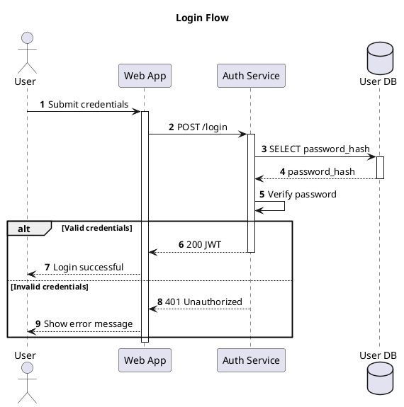
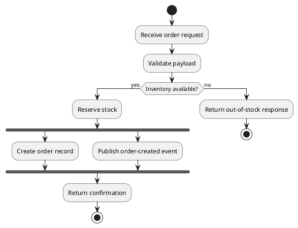
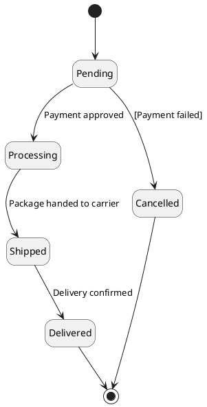
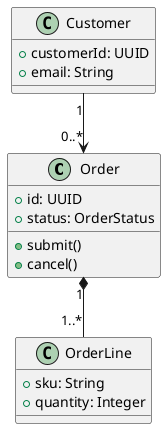
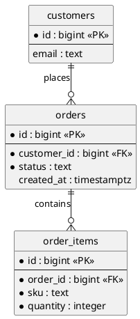

# PlantUML (PUML) Diagrams

Use this skill when creating or reviewing PlantUML diagrams that need to be readable,
maintainable, and suitable for repository documentation. Prefer focused diagrams that answer
one question for one audience. Treat `.puml` files as source code: one diagram per file,
version-controlled alongside the thing they describe, styled through shared includes rather
than copy-pasted `skinparam` blocks.

For preprocessor directives, layout control, and the skinparam-vs-`<style>` migration, see
`references/layout-and-styling.md`. For CI/pre-commit rendering pipelines, per-platform
embedding details, and generating diagrams from source (OpenAPI, DB schema, Python), see
`references/tooling-and-generation.md`.

## Diagram Workflow

Before writing diagram code:

1. Identify the audience and the question the diagram must answer.
2. Choose the smallest diagram type that communicates that view clearly.
3. Decide whether to store the diagram as a standalone `.puml` file or embed it in markdown —
   this decision depends on where it will be viewed; see Platform Rendering Reality below
   before assuming any platform renders PlantUML the same way GitHub renders Mermaid.
4. Prefer local includes and local themes over remote dependencies.
5. Validate syntax and rendering when tooling exists; if not, state that the diagram was not
   render-validated.

## Core Rules

- One diagram per `.puml` file; it should explain one view or interaction.
- Store diagrams as code alongside the relevant documentation, conventionally under
  `docs/diagrams/` (or `docs/architecture/diagrams/`) mirroring the code structure, with a
  sibling `globals/` or `_styles/` directory for shared includes. See File Organization below.
- Use consistent layout direction and naming within a document set.
- Label arrows with real protocols, commands, events, or data contracts.
- Add notes or legends only when they reduce ambiguity.
- Split diagrams when they become crowded, cross heavily, or exceed a readable scope — this is
  the single most effective fix for PlantUML's Graphviz-driven layout getting confused on large
  graphs; don't spend a long time fighting layout hints before trying this first.
- Prefer generating a diagram from its source of truth (DB schema, OpenAPI spec, Python domain
  model) over hand-maintaining one that will drift. See
  `references/tooling-and-generation.md` for concrete tools.

## Platform Rendering Reality

Verify where a diagram will actually be viewed before assuming it renders. This is the most
consequential thing to get wrong, since it's invisible until someone opens the file on the
platform in question:

| Platform | Native PlantUML support | What to do |
|---|---|---|
| **GitHub** | **No.** GitHub renders Mermaid natively but PlantUML support isn't scheduled. | Render to SVG/PNG in CI and commit/link the image, or use the public PlantUML proxy in an `` image URL, or a browser extension for local viewing. Don't commit a bare `.puml` expecting it to render in a README or PR diff preview. |
| **GitLab** | Yes, but only after an admin configures a **PlantUML server** for the instance. | Use a fenced `plantuml` code block; GitLab always rasterizes to PNG. The `::include` directive can pull a `.puml` from the repo but only resolves post-commit, not in the editor preview. |
| **Confluence** | No native support. | Requires a Marketplace app; several exist, and cloud-hosted ones typically send your diagram source to a vendor render server — self-host a PlantUML server if the diagram content is sensitive. |
| **MkDocs** | No native support. | Add a plugin: `plantuml-markdown` (fenced blocks via `pymdownx.superfences`), `mkdocs-build-plantuml-plugin` (pre-generates images), or `mkdocs-plantuml-local` (renders without a public server). |
| **Docusaurus** | No native support. | Typically `remark-kroki` (via a Kroki server) or a remark PlantUML plugin. |
| **Antora** | No native support. | `asciidoctor-kroki` pointed at a Kroki server; keep source in `partials/` and `include::` it into a `[plantuml]` block. |

If a diagram must render with zero build step directly in a GitHub PR or README, that's a
signal to use Mermaid for that specific diagram instead — see Formatting and Maintenance below.

## File Organization

- **One diagram per `.puml` file.** `.puml` is the standalone-diagram extension; use `.iuml`
  ("include UML") by convention for fragments meant to be `!include`d and never rendered on
  their own — PlantUML doesn't require either extension (it keys off `@startuml`), but the
  distinction signals intent to the next reader.
- A common, worth-adopting layout: `docs/diagrams/` (or `docs/architecture/diagrams/`) holding
  individual `.puml` files, plus a sibling `globals/` (or `_styles/`) directory holding a shared
  `stylesheet.iuml` that centralizes `skinparam`/colors/legend conventions and is `!include`d
  from every diagram. A change to the stylesheet then propagates everywhere instead of needing
  a find-and-replace across every diagram file.
- Use descriptive, kebab-case file names that name the view, not just the subject:
  `auth-login-sequence.puml`, `checkout-container-view.puml` — not `diagram1.puml` or
  `orders.puml`.

## 1. Sequence Diagrams

Use sequence diagrams for request flows, async interactions, orchestration logic, and
cross-service behavior over time. Sequence diagrams do **not** require Graphviz to render
(PlantUML lays them out itself) — they're the safest diagram type to use in an environment
where Graphviz isn't installed or you want to avoid the dependency.

### Best Practices

- Use `autonumber` by default unless numbering adds noise.
- Pick accurate participant types: `actor`, `participant`, `database`, `queue`,
  `collections`.
- Keep activation and deactivation balanced across all branches.
- Use `alt`, `opt`, `loop`, `par`, and `group` blocks for control flow.
- Distinguish sync and async messaging intentionally with arrow styles.

### Example



## 2. Architecture and C4 Diagrams

Use component, container, context, or deployment-style views for system structure and
boundaries. If the project already uses the C4-PlantUML library, stay consistent with it. C4
diagrams (like most non-sequence UML types below) need a working Graphviz install to render —
confirm the render environment has it, or fall back to `!pragma layout smetana` if it doesn't
(see `references/layout-and-styling.md`).

### Best Practices

- Prefer C4 for context/container/component views when the repo already supports it. Get most
  of the value from **Context and Container** levels; use **Component** only for a genuinely
  complex container; skip **Code/Level 4** entirely unless it's generated from source — hand-
  drawn code-level diagrams go stale almost immediately.
- Prefer local includes such as `!include ./vendor/c4/C4_Container.puml`, or the version
  bundled in the PlantUML standard library (`!include <C4/C4_Container>`) if the project
  doesn't vendor its own copy.
- Do not assume remote `!include` (URL form) access is available in the render environment.
- If local C4 macros are unavailable, fall back to plain PlantUML shapes instead of blocking.
- Show trust boundaries, external systems, and protocols explicitly.
- Use `left to right direction` (or `LAYOUT_LEFT_RIGHT()` in C4) when it improves readability
  and reduces vertical sprawl.
- Common macros beyond the example below: `Person_Ext`/`System_Ext` for things outside the
  boundary, `Container_Boundary` for grouping within a system, and directional
  `Rel_U`/`Rel_D`/`Rel_L`/`Rel_R` when the default relationship layout looks wrong.
  `SHOW_LEGEND()` or `SHOW_FLOATING_LEGEND()` renders the standard C4 legend.
- If applying a C4 theme (names beginning `C4_`, e.g. `C4_united`), the `!theme ... from ...`
  line must come **before** the C4 `!include` statements, not after.

### C4 Example

```plantuml
@startuml
!include ./vendor/c4/C4_Container.puml
LAYOUT_LEFT_RIGHT()

Person(customer, "Customer", "Places orders")
System_Boundary(system, "E-Commerce Platform") {
    Container(web_app, "Web App", "Angular", "Customer-facing UI")
    Container(order_api, "Order API", "FastAPI", "Handles checkout and orders")
    ContainerDb(order_db, "Order DB", "PostgreSQL", "Orders and payment state")
}
System_Ext(payment_gateway, "Payment Gateway", "External card processor")

Rel(customer, web_app, "Uses", "HTTPS")
Rel(web_app, order_api, "Submits orders", "HTTPS/JSON")
Rel(order_api, order_db, "Reads and writes", "SQL")
Rel(order_api, payment_gateway, "Charges card", "HTTPS/JSON")
@enduml
```

### Plain PlantUML Fallback

If C4 macros are unavailable, use `package`, `component`, `database`, `cloud`, and `node`
constructs to produce an equivalent focused view.

## 3. Activity Diagrams

Use activity diagrams for business workflows, decision logic, approvals, batch processing,
and procedural flows.

### Best Practices

- Use the modern syntax shown below (`start`/`stop`/`:action;`/`if`) — it doesn't require
  Graphviz. The older arrow-based activity syntax (`(*) --> "action"`) still works but is no
  longer recommended for new diagrams.
- Start with `start` and end with `stop` or `end`.
- Use `if` / `else` or `switch` constructs for decision branches.
- Use `fork` / `fork again` / `end fork` for parallel paths.
- Use partitions or swimlanes when ownership matters.
- Keep action labels short and verb-led.

### Example



## 4. State Diagrams

Use state diagrams for lifecycle modeling of entities such as orders, tickets, jobs, or
documents.

### Best Practices

- Always define the initial `[*]` and terminal `[*]` states.
- Put triggers or events on transitions.
- Add guard conditions as `[condition]` where business rules matter.
- Use composite states when a lifecycle would otherwise sprawl.

### Example



## 5. Class Diagrams

Use class diagrams when modeling static structure, domain concepts, inheritance, key fields,
or high-level API relationships. Do not turn them into full code dumps.

### Best Practices

- Show only the attributes and methods needed for the discussion.
- Prefer domain meaning over implementation noise.
- Mark multiplicity on relationships where it matters.
- Use composition and aggregation intentionally; do not add arrows without meaning.
- Group related concepts with `package` when the model spans multiple bounded areas.

### Example



## 6. ER Diagrams

Use ER diagrams for relational database schemas — distinct from class diagrams, which model
domain objects and behavior. PlantUML supports both Chen's notation and the Information
Engineering (crow's-foot) notation; prefer crow's-foot for anything a backend/DBA audience will
read, since it's the more widely recognized convention for relational schemas.

### Best Practices

- Use `entity` blocks with primary/foreign keys marked, and crow's-foot cardinality markers
  (`||`, `o{`, etc.) on relationships.
- Add `hide circle` and `skinparam linetype ortho` for cleaner, more schema-like output — the
  default rendering is noisier than most DB documentation needs.
- Generate this diagram type from the live schema where possible (a schema-introspection tool)
  rather than hand-maintaining it — a hand-drawn ER diagram for an actively-migrated schema is
  one of the fastest diagrams to go stale. See `references/tooling-and-generation.md`.

### Example



## 7. Deployment Diagrams

Use deployment diagrams for runtime topology, infrastructure boundaries, hosting locations,
and network-relevant communication paths. Needs Graphviz, like most non-sequence types above.

### Best Practices

- Use `node`, `cloud`, `database`, and `artifact` to reflect runtime reality.
- If the project already uses C4-PlantUML, `C4_Deployment.puml` is usually the cleanest way to
  express this rather than plain PlantUML deployment shapes — stay consistent with whichever
  the repo has already established.
- Show environment or trust boundaries clearly.
- Label connections with transport and port details when relevant.
- Do not mix deep code structure into deployment views.

## 8. Formatting and Maintenance

- Define styling at the top of the file and keep it consistent across related diagrams —
  prefer pulling it from a shared `!include`d stylesheet over repeating a `skinparam` block per
  file. `skinparam` is being phased out in favor of a CSS-like `<style>` block, but it remains
  the more broadly compatible option across renderers/platforms today (see
  `references/layout-and-styling.md` for the tradeoff).
- Prefer repository-local themes and shared include files for consistency.
- Use descriptive names such as `auth-login-sequence.puml` or `checkout-container-view.puml`.
- Use comments sparingly to explain non-obvious modeling decisions.
- When embedding in markdown, use fenced `plantuml` blocks — but confirm the target platform
  actually renders them first (see Platform Rendering Reality above); GitHub won't.
- Only switch to Mermaid or another format if the user explicitly requests it, or the diagram
  specifically needs to render natively in a GitHub PR/README with no build step.
- A diagram that requires manual effort to keep current and duplicates information already
  available from code, an IDE, or another generated doc is a candidate for deletion or
  generation, not permanent hand-maintenance — see `references/tooling-and-generation.md`.

## 9. Cross-Diagram Consistency

Per-file correctness (right type, closed blocks, valid syntax) does not catch drift *between*
the diagrams in a set. A diagram set is a distributed description of one system, and the
highest-value defects only appear when you read the whole set together — a producer with no
consumer, a capability named in an overview but absent from the detail views, a silently-dropped
step. After the per-file checks, run a **whole-set consistency pass** when delivering or
reviewing more than one related diagram:

- **Every published event/message/topic has a consumer somewhere in the set.** If diagram A
  shows a service publishing an event, some diagram in the set must show something consuming it
  (or a note must explain why not). A dangling producer is the most common set-level defect.
- **Capabilities named in an overview diagram have a path in the detail diagrams.** If a
  context/overview diagram gives an actor or system a responsibility (e.g. "admin manages
  templates"), a container/component/sequence diagram must show the route or interaction that
  delivers it. Overview promises that no detail view fulfils are a real gap, not a simplification.
- **Numbered steps are contiguous, or the gap is explained.** If a sequence or activity diagram
  numbers its steps (1-2, 3-4, …), a jump (7-8 → 10-11) must be intentional and annotated with a
  note saying where the missing step lives — otherwise a reader reads it as a mistake.
- **Everything a diagram's title or legend claims is actually rendered.** If the title says
  "retry, DLQ, and replay", each of those must be a visible element — not left in a `'` comment
  (which never renders) or dropped entirely. Grep the rendered output, not just the source.
- **Shared entities are named and cased identically across the set.** The same service,
  topic, table, or actor should carry one canonical name in every diagram; silent renames read
  as different things.

When a check fails, fix the diagram that is wrong — usually by adding the missing edge/consumer,
adding a note that explains the intentional gap, or correcting the name — not by deleting the
signal that surfaced it.

## Anti-pattern quick reference

| Anti-pattern | Instead |
|---|---|
| Delivering a multi-diagram set without a whole-set consistency pass (dangling events, overview capabilities with no detail path, non-contiguous step numbers, title claims that don't render) | Run the §9 Cross-Diagram Consistency checks across the whole set after the per-file checks |
| Committing a bare `.puml` expecting it to render in a GitHub README/PR diff | GitHub has no native PlantUML support — render to SVG/PNG in CI and commit/link the image, or use a render proxy |
| Assuming Confluence/MkDocs/Docusaurus/Antora render PlantUML out of the box | None have native support — add the platform-specific plugin or Kroki/PlantUML server integration first |
| Fighting Graphviz layout hints for a long time on a crowded diagram | Split the diagram — this is the single most effective fix for confused auto-layout on large graphs |
| Full code dumps in a class/component diagram | High-level API relationships and structure only |
| Arrows added without meaning, or DB tables treated as spreadsheets | Composition/aggregation used intentionally; label arrows with real protocols, commands, or contracts |
| Mixing deep code structure into a deployment view | Keep deployment diagrams at the infrastructure/topology level |
| Assuming remote `!include` (URL form) is available in the render environment | Local includes and repository-local themes |
| Repeating a `skinparam` block per file | A shared `!include`d stylesheet, kept consistent across related diagrams |
| Hand-maintaining a diagram that duplicates info already in code/IDE/another doc | Generate it from source of truth (DB schema, OpenAPI, domain model) instead |
| Switching to Mermaid without a reason | Only switch when the user asks, or GitHub-native no-build-step rendering is required |

## Pre-flight checklist — run before delivering any PlantUML diagram

When asked to produce or review a PUML diagram, ensure you:

- [ ] Chose the right diagram type for the question being answered.
- [ ] Kept the diagram focused on one audience and one view.
- [ ] Used clear names, aliases, and arrow labels.
- [ ] Closed all control-flow blocks and balanced activations where applicable.
- [ ] Resolved local includes, theme references, and library dependencies.
- [ ] Confirmed whether the target platform renders PlantUML natively, and planned to commit a
  rendered image or use a render proxy/CI step if not (see Platform Rendering Reality).
- [ ] Used a diagram type that matches the available render environment — sequence and
  modern-syntax activity diagrams don't need Graphviz; most other types do.
- [ ] Used C4 macros only when the library is available locally or already established.
- [ ] Split the diagram if it is visually dense or mixes unrelated concerns.
- [ ] For a diagram *set*: ran the §9 Cross-Diagram Consistency checks — every published event has a consumer, overview capabilities have detail-view paths, numbered steps are contiguous or annotated, and every title/legend claim actually renders.
- [ ] Added notes, legends, or titles only where they improve comprehension.
- [ ] Render-validated the diagram when tooling exists, or explicitly noted that render
  validation was not performed.
