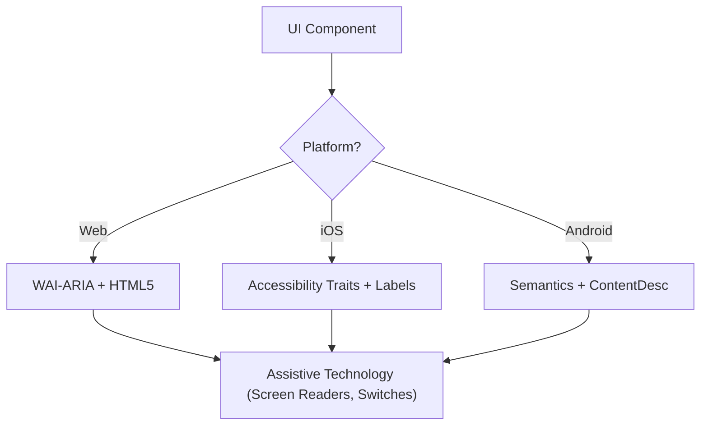

# Accessibility (WCAG 2.2)

Digital interfaces must be Perceivable, Operable, Understandable, and Robust (POUR) for every
user, including those on screen readers, switch controls, or keyboard-only navigation. This
skill covers both the platform-agnostic WCAG 2.2 discipline and, for the Web, the concrete
React/Next.js code that implements it.

## Core concepts

- **POUR**: the four WCAG pillars — Perceivable, Operable, Understandable, Robust.
- **Semantic mapping**: prefer the native element or platform primitive that already carries
  the right accessibility behavior over a generic container plus custom attributes.
- **Accessibility tree**: the representation of the UI that assistive technology actually reads
  — not the visual DOM/view tree.
- **Focus management**: controlling where the keyboard/screen-reader cursor goes and in what
  order, especially across state changes (modals opening, routes changing).
- **Labeling and hints**: giving every control a name and, where useful, extra context, via
  `aria-label`/`accessibilityLabel`/`contentDescription` and their `-hint`/`-describedby`
  counterparts.

## Working through a component

1. **Identify the role.** Is it a button, a link, a tab? Use the most semantic native element
   available before reaching for a custom `role`.
2. **Perceivable.** Text contrast >= 4.5:1 (normal text) or 3:1 (large text / UI components).
   Text alternatives for all non-text content. Reflow works up to 400% zoom without losing
   function or content.
3. **Operable.** Interactive targets are at least 24x24 CSS px on the Web (WCAG 2.2 SC 2.5.8)
   or 44x44pt on native. Every interactive element is keyboard-reachable with a visible focus
   indicator (SC 2.4.11). Dragging interactions offer a single-pointer alternative.
4. **Understandable.** Navigation stays consistent across the product. Error messages describe
   the problem and suggest a fix (SC 3.3.3). Don't ask the user for the same data twice when
   avoidable (SC 3.3.7, "Redundant Entry").
5. **Robust.** Every control exposes a correct `Name, Role, Value`. Dynamic updates use
   `aria-live` or an equivalent live region so assistive tech announces them.

## Cross-platform mapping



| Feature | Web (HTML/ARIA) | iOS (SwiftUI) | Android (Compose) |
|---|---|---|---|
| Primary label | `aria-label` / `<label>` | `.accessibilityLabel()` | `contentDescription` |
| Secondary hint | `aria-describedby` | `.accessibilityHint()` | `Modifier.semantics { stateDescription = ... }` |
| Action role | `role="button"` | `.accessibilityAddTraits(.isButton)` | `Modifier.semantics { role = Role.Button }` |
| Live updates | `aria-live="polite"` | `.accessibilityLiveRegion(.polite)` | `Modifier.semantics { liveRegion = LiveRegionMode.Polite }` |

### iOS: accessible action button

```swift
Button(action: deleteItem) {
    Image(systemName: "trash")
}
.accessibilityLabel("Delete item")
.accessibilityHint("Permanently removes this item from your list")
.accessibilityAddTraits(.isButton)
```

### Android: accessible toggle

```kotlin
Switch(
    checked = isEnabled,
    onCheckedChange = { onToggle() },
    modifier = Modifier.semantics {
        contentDescription = "Enable notifications"
    }
)
```

## Web/React implementation

The platform-agnostic rules above land, on the Web, as these concrete patterns. Missing
`htmlFor`/`id` pairing and disconnected error messages are the most common issues flagged in
code review — fix those first.

### Form labeling

```tsx
// Bad — label has no programmatic connection to the input
<label>Email</label>
<input type="email" />

// Good — htmlFor matches input id
<label htmlFor="email">Email</label>
<input id="email" type="email" />
```

```tsx
// Bad — a visual-only asterisk conveys nothing to a screen reader
<label htmlFor="email">Email *</label>
<input id="email" type="email" />

// Good — required enables native validation; aria-required signals it to assistive tech
<label htmlFor="email">
  Email <span aria-hidden="true">*</span>
</label>
<input id="email" type="email" required aria-required="true" />
```

```tsx
// Bad — error text is visually present but not linked to the input
<input id="email" type="email" />
<span className="error">Invalid email address</span>

// Good — aria-describedby connects the input to its error; aria-invalid marks the state
<input id="email" type="email" aria-describedby="email-error" aria-invalid={!!error} />
{error && <span id="email-error" role="alert">{error}</span>}
```

A complete form combining all three:

```tsx
export function LoginForm({ onSubmit }: { onSubmit: (email: string, password: string) => void }) {
  const [email, setEmail] = useState('');
  const [password, setPassword] = useState('');
  const [errors, setErrors] = useState<{ email?: string; password?: string }>({});

  const handleSubmit = (e: React.FormEvent) => {
    e.preventDefault();
    const newErrors: typeof errors = {};
    if (!email) newErrors.email = 'Email is required';
    if (!password) newErrors.password = 'Password is required';
    if (Object.keys(newErrors).length) { setErrors(newErrors); return; }
    onSubmit(email, password);
  };

  return (
    <form onSubmit={handleSubmit} noValidate>
      <div>
        <label htmlFor="email">Email <span aria-hidden="true">*</span></label>
        <input
          id="email" type="email" value={email} onChange={e => setEmail(e.target.value)}
          aria-required="true"
          aria-describedby={errors.email ? 'email-error' : undefined}
          aria-invalid={!!errors.email}
          autoComplete="email"
        />
        {errors.email && <span id="email-error" role="alert">{errors.email}</span>}
      </div>
      <div>
        <label htmlFor="password">Password <span aria-hidden="true">*</span></label>
        <input
          id="password" type="password" value={password} onChange={e => setPassword(e.target.value)}
          aria-required="true"
          aria-describedby={errors.password ? 'password-error' : undefined}
          aria-invalid={!!errors.password}
          autoComplete="current-password"
        />
        {errors.password && <span id="password-error" role="alert">{errors.password}</span>}
      </div>
      <button type="submit">Log in</button>
    </form>
  );
}
```

### Semantic HTML before ARIA

```tsx
// Bad — no role, no keyboard support, no accessible name
<div onClick={handleClick}>Submit</div>
// Good — button is focusable, activates on Enter/Space, announces as "button"
<button type="button" onClick={handleClick}>Submit</button>

// Bad — non-semantic navigation loses right-click/middle-click/keyboard support
<div onClick={() => navigate('/home')}>Home</div>
// Good
<a href="/home">Home</a>

// Bad — heading hierarchy skips a level (h1 -> h4)
<h1>Dashboard</h1><h4>Recent Activity</h4>
// Good — sequential levels
<h1>Dashboard</h1><h2>Recent Activity</h2>
```

### ARIA attributes — only when native semantics fall short

Wrong ARIA is worse than no ARIA.

```tsx
// aria-label: inline string — use when no visible label text exists
<button aria-label="Close modal"><XIcon /></button>

// aria-labelledby: references another element's text — use when a visible label exists
<section aria-labelledby="section-title">
  <h2 id="section-title">Recent Orders</h2>
</section>

// aria-describedby: supplementary description beyond the label
<button aria-describedby="delete-warning" onClick={handleDelete}>Delete account</button>
<p id="delete-warning">This action cannot be undone.</p>

// aria-live: announce content that updates without a page reload.
// polite waits for the user's current action to finish; assertive interrupts —
// reserve assertive for urgent errors only.
export function StatusMessage({ message, isError }: { message: string; isError?: boolean }) {
  return (
    <div role="status" aria-live={isError ? 'assertive' : 'polite'} aria-atomic="true">
      {message}
    </div>
  );
}

// aria-expanded / aria-controls for disclosure widgets
export function Accordion({ title, children }: { title: string; children: React.ReactNode }) {
  const [isOpen, setIsOpen] = useState(false);
  const contentId = useId();
  return (
    <div>
      <button aria-expanded={isOpen} aria-controls={contentId} onClick={() => setIsOpen(p => !p)}>
        {title}
      </button>
      <div id={contentId} hidden={!isOpen}>{children}</div>
    </div>
  );
}
```

### Keyboard navigation — custom dropdown

Every interactive element must be reachable and operable by keyboard alone.

```tsx
export function Dropdown({ options, onSelect }: { options: string[]; onSelect: (value: string) => void }) {
  const [isOpen, setIsOpen] = useState(false);
  const [activeIndex, setActiveIndex] = useState(0);
  const listId = useId();
  if (!options.length) return null;

  const handleKeyDown = (e: React.KeyboardEvent) => {
    switch (e.key) {
      case 'ArrowDown': e.preventDefault(); setActiveIndex(i => Math.min(i + 1, options.length - 1)); break;
      case 'ArrowUp':   e.preventDefault(); setActiveIndex(i => Math.max(i - 1, 0)); break;
      case 'Enter':
      case ' ':
        e.preventDefault();
        if (isOpen) onSelect(options[activeIndex]);
        setIsOpen(prev => !prev);
        break;
      case 'Escape': setIsOpen(false); break;
    }
  };

  return (
    <div role="combobox" aria-expanded={isOpen} aria-haspopup="listbox" aria-controls={listId}
      tabIndex={0} onKeyDown={handleKeyDown} onClick={() => setIsOpen(prev => !prev)}>
      <span>{options[activeIndex]}</span>
      {isOpen && (
        <ul id={listId} role="listbox">
          {options.map((option, index) => (
            <li key={option} role="option" aria-selected={index === activeIndex}
              onClick={() => { onSelect(option); setIsOpen(false); }}>
              {option}
            </li>
          ))}
        </ul>
      )}
    </div>
  );
}
```

### Focus management — modal with restoration

Focus must move logically as UI state changes, especially for modals and route transitions.
The example below covers initial focus and restoring focus to the trigger on close. For a full
focus trap (Tab/Shift+Tab cycling within the modal), use a library such as
[`focus-trap-react`](https://github.com/focus-trap/focus-trap-react), which handles edge cases
like dynamic content and nested portals.

```tsx
export function Modal({ isOpen, onClose, title, children }: {
  isOpen: boolean; onClose: () => void; title: string; children: React.ReactNode;
}) {
  const modalRef = useRef<HTMLDivElement>(null);
  const previousFocusRef = useRef<HTMLElement | null>(null);

  useEffect(() => {
    if (isOpen) {
      previousFocusRef.current = document.activeElement as HTMLElement;
      modalRef.current?.focus();
    } else {
      previousFocusRef.current?.focus();
    }
  }, [isOpen]);

  if (!isOpen) return null;

  return (
    <div ref={modalRef} role="dialog" aria-modal="true" aria-labelledby="modal-title"
      tabIndex={-1} onKeyDown={e => e.key === 'Escape' && onClose()}>
      <h2 id="modal-title">{title}</h2>
      {children}
      <button onClick={onClose}>Close</button>
    </div>
  );
}
```

### Images, icons, and reduced motion

```tsx
// Decorative — hidden from screen readers

// Meaningful — describes the content

// Icon-only button needs its own label
<button aria-label="Delete item"><TrashIcon aria-hidden="true" /></button>
```

```tsx
export function useReducedMotion(): boolean {
  const [prefersReduced, setPrefersReduced] = useState(false);
  useEffect(() => {
    const mq = window.matchMedia('(prefers-reduced-motion: reduce)');
    setPrefersReduced(mq.matches);
    const handler = (e: MediaQueryListEvent) => setPrefersReduced(e.matches);
    mq.addEventListener('change', handler);
    return () => mq.removeEventListener('change', handler);
  }, []);
  return prefersReduced;
}
```

For the motion system this hook plugs into, see `zeno-motion-ui`. For asserting these patterns
in tests (`jest-axe`/`vitest-axe`), see `zeno-react-testing`.

## Anti-pattern quick reference

| Anti-pattern | Instead |
|---|---|
| `<div>`/`<span>` with `onClick` and no role/keyboard support | Use `<button>` or add `role`, `tabIndex={0}`, and `onKeyDown` |
| Color as the only signal for error/status | Pair color with text, icon, or `aria-invalid` |
| Modal that doesn't trap or doesn't release focus | Trap focus while open; restore it to the trigger on close, escapable via `Escape` or a close button |
| `alt="Image of..."` / `"Picture of..."` | Describe the content directly — screen readers already announce the role |
| `aria-label` on a `<div>` with no role | Use a real interactive element, or add the matching `role` |
| `aria-hidden="true"` on a focusable element | Never hide a focusable control — keyboard users get trapped on it |
| `role="button"` on a `<div>` without a keyboard handler | Add `tabIndex={0}` and `onKeyDown` for Enter/Space, or use `<button>` |
| Placeholder text used as the only label | A real `<label htmlFor>`; placeholder disappears once the user types |
| Positive `tabIndex` values | `tabIndex={0}` or `-1` only — positive values break natural tab order |

## Pre-flight checklist — run before delivering any accessible component or audit

- [ ] Interactive elements meet 24x24 CSS px (Web) or 44x44pt (Native) minimum target size
- [ ] Focus indicators are visible and high-contrast; tab order follows visual/reading order
- [ ] Modals trap focus while open and restore it to the trigger on close
- [ ] Dropdowns/menus restore focus to the trigger and support arrow-key navigation plus Escape
- [ ] Every `<input>`/`<select>`/`<textarea>` has a connected label; errors use `aria-describedby` + `role="alert"`
- [ ] Icon-only buttons and decorative images are labeled or hidden correctly (`aria-label` / `alt="" aria-hidden`)
- [ ] Dynamic content updates use `aria-live`, and text reflows correctly at 400% zoom
- [ ] `prefers-reduced-motion` is respected for any animation
